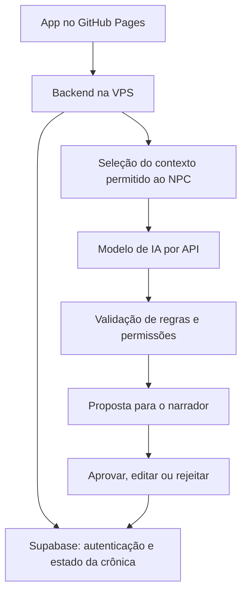

# Plano de IA para ações de NPCs

Status: proposta para evolução futura; nenhuma implementação autorizada por este documento.

## Objetivo

Permitir que a IA proponha ações e falas de NPCs de Greenmond, respeitando a personalidade, o conhecimento individual e os acontecimentos aprovados da crônica. Preservar a autoridade dos narradores sobre o conteúdo oficial.

## Infraestrutura considerada

- Frontend atual no GitHub Pages.
- Supabase para autenticação e persistência.
- VPS Contabo informada pelo usuário: 8 GB de RAM e 4 CPUs.
- Ausência de GPU é uma hipótese a verificar, assim como a capacidade disponível e os serviços já instalados na VPS.

O frontend pode permanecer no GitHub Pages. O processamento da IA e as credenciais ficam no backend.

## Opções de comportamento

| Opção | Funcionamento | Vantagem | Dificuldade principal |
| --- | --- | --- | --- |
| Assistente do narrador | O narrador escolhe um NPC e uma situação; a IA sugere ações e falas. | Controle e implementação simples. | Depende da iniciativa do narrador. |
| NPC reativo | Uma ação de jogador gera uma proposta de reação do NPC envolvido. | O cenário responde aos acontecimentos. | Determinar quem presenciou ou soube de cada evento. |
| NPC por turnos | Ao encerrar uma cena ou avançar a noite, os NPCs propõem ações conforme objetivos e recursos. | Movimentação fora das cenas dos jogadores. | Continuidade e resolução de ações conflitantes. |
| Simulação autônoma | NPCs agem periodicamente, relacionam-se e produzem acontecimentos. | Maior sensação de mundo vivo. | Custo, supervisão e risco de desvios narrativos. |

Recomendação: começar pelo assistente do narrador, evoluir para NPCs reativos e avaliar turnos posteriormente. A simulação autônoma depende de regras de mundo e critérios de autorização bem definidos.

## Opções de execução do modelo

| Implementação | Papel da VPS | Avaliação |
| --- | --- | --- |
| Modelo externo por API | Autenticação, contexto, regras, fila e chamadas ao modelo. | Recomendação inicial: pouca exigência de processamento local e custo variável por uso. |
| Modelo local com Ollama | Executa também o modelo. | Experimento possível com modelos pequenos; concorrência, qualidade e velocidade precisam de medição. |
| Híbrida | Regras e tarefas simples locais; geração narrativa em API externa. | Evolução possível quando o volume justificar a complexidade. |
| Supabase e API externa | Edge Function coordena solicitações curtas, sem usar a VPS. | Alternativa para o assistente inicial; execução contínua exige organizar processamento em segundo plano. |

Assumindo uma VPS sem GPU, usá-la inicialmente como servidor da aplicação. Não adotar um modelo local como base da experiência antes de testes reais.

Como referência, o catálogo do Ollama lista o Qwen3 4B com arquivo de aproximadamente 2,5 GB. O tamanho do arquivo não representa o consumo total de RAM: contexto, execução e outros serviços também ocupam memória. Caber no servidor não garante desempenho ou qualidade suficientes. Modelos e requisitos devem ser reavaliados na implementação.

## Arquitetura recomendada

- Verificar a identidade e a permissão do usuário em cada solicitação.
- Manter a chave da IA exclusivamente no backend.
- Enviar ao modelo somente o contexto necessário e permitido ao NPC.
- Receber uma proposta estruturada; o backend valida e controla sua execução.
- Registrar no histórico oficial apenas resultados aprovados.
- Definir limites de consumo, tempo de execução e número de ações.

O padrão de function calling permite que o modelo solicite operações definidas pela aplicação. O código continua responsável por autorizar, validar e executar essas operações. O provedor e o modelo ainda precisam ser escolhidos.

## Dados necessários por NPC

As definições narrativas novas dependem de aprovação do usuário; não devem ser inferidas como fatos a partir de lacunas do acervo.

- **Personalidade e limites:** comportamento, prioridades e coisas que não faria.
- **Objetivos:** o que pretende alcançar na situação atual.
- **Conhecimento:** fatos conhecidos, suspeitas e informações desconhecidas.
- **Relações e recursos:** vínculos, disponibilidade e meios de agir.
- **Memória dos acontecimentos:** ações aprovadas e consequências.

O conhecimento deve ser separado por NPC no backend. Um segredo armazenado no banco não deve entrar automaticamente no contexto de todos os personagens.

Separar intenção de resultado: a IA pode propor investigar um local, mas a descoberta depende das regras, das circunstâncias e, quando aplicável, da decisão do narrador. A IA não deve garantir o sucesso da própria ação.

## Primeira entrega proposta

Escopo: um NPC escolhido pelo usuário, em uma área privada de **Escrita e revisão**.

1. O narrador informa a situação e seleciona os acontecimentos relevantes.
2. A IA apresenta uma ação proposta, uma possível fala e a justificativa baseada no contexto.
3. O narrador aprova, edita ou rejeita a proposta.
4. Apenas o resultado aprovado entra no histórico oficial.
5. Registrar consumo, tempo de resposta e problemas de continuidade para avaliar a solução.

### Critérios de aceitação

- Usuários sem permissão de narrador não conseguem gerar ou aprovar propostas pelo backend.
- O contexto enviado respeita o conhecimento e a visibilidade do NPC.
- Propostas rejeitadas não alteram o estado oficial da crônica.
- A aprovação registra a autoria da revisão e não duplica a ação em tentativas repetidas.
- Falhas e limites do provedor preservam o estado anterior e permitem nova tentativa controlada.
- O narrador consegue revisar a proposta antes de qualquer efeito oficial.

## Evolução posterior

1. Validar qualidade, custo e continuidade com o assistente para um NPC.
2. Ampliar para outros NPCs com definições narrativas aprovadas.
3. Permitir propostas de reação a eventos, respeitando quem teve conhecimento deles.
4. Avaliar processamento por turnos, com limites de ações e orçamento por execução.
5. Considerar autonomia parcial ou simulação somente após definir quais efeitos dispensam aprovação.

## Decisões pendentes

- NPC e situação usados no piloto.
- Provedor, modelo e orçamento de consumo.
- Disponibilidade real da VPS, serviços existentes e forma de operação do backend.
- Definições privadas de conhecimento, objetivos, recursos e relações dos NPCs.
- Regras para resolver ações, publicar resultados e avançar o tempo da crônica.
- Política de envio de conteúdo privado ao provedor escolhido.

## Referências

- [Catálogo oficial do Qwen3 no Ollama](https://ollama.com/library/qwen3).
- [Documentação de function calling da OpenAI](https://developers.openai.com/api/docs/guides/function-calling).

Recomendação registrada: **GitHub Pages + backend pequeno na VPS + Supabase + IA externa, inicialmente com aprovação do narrador**.
